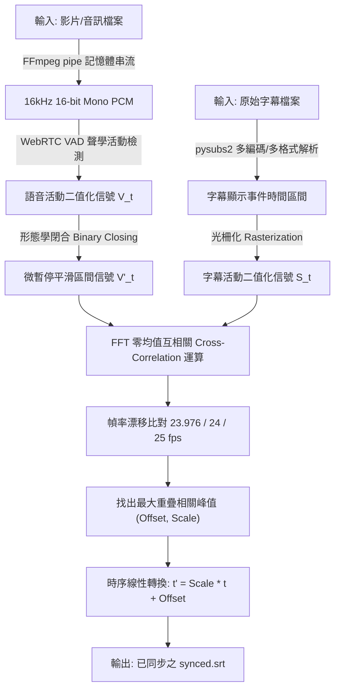

# AutoSubSync | 電影字幕時序自動校正工作站

> **AutoSubSync** 是一款基於 **語音活動檢測（WebRTC VAD）** 與 **快速傅立葉變換互相關（FFT Cross-Correlation）** 的影音字幕自動校正工具。  
> 專為解決在網路上找到的字幕與本地電影出現**時差偏移**或**幀率不同步（越看越慢/越看越快）**之痛點而開發。  
> 無需昂貴的 GPU 算力，數秒至十餘秒內即可完成全片比對並產出完美對齊的新字幕。

---

## 核心特性 (Key Features)

- **[極速演算法 / 免 GPU]**：直接比對人聲特徵波形與字幕出現區間，透過 FFT 零均值互相關求出最佳平移量，一部 2 小時電影約 10~30 秒即可完成對齊。
- **[雙維度時序修正]**：
  - **固定時間差 (Constant Offset)**：自動修復因片頭商標、贊助商片段導致的整體延遲或超前。
  - **幀率漂移 (Framerate Drift)**：自動辨識電影標準幀率換算比（如 23.976 fps、24 fps、25 fps PAL 加速），修正長片隨時間累積的線性發散。
- **[專業工作站級暗色 UI (NLE Studio Style)]**：
  - 承襲 DaVinci Resolve 與 Premiere Pro 實用主義風格。
  - **全直角 0px 邊框**、**霧面深炭灰純色調**、**零 Emoji 純工程標籤**。
  - 支援 Windows 檔案直接拖曳導入、自動尋找同目錄字幕、一鍵開啟檔案總管標記輸出。
- **[100% 靜默雙擊啟動]**：提供專用 `.vbs` 靜默宿主與桌面捷徑，啟動 GUI 時完全不召喚任何黑底 CMD 終端機視窗。
- **[零磁碟負擔 / Memory Streaming]**：透過 FFmpeg pipe 於記憶體即時解碼為 16kHz PCM，不佔用硬碟空間，不產生動輒數 GB 的中間 WAV 暫存檔。
- **[跨語言與全格式支援]**：
  - 以聲音物理頻段能量為準，英語、日語、韓語、國語等全語種通用。
  - 支援 `.srt`、`.ass`、`.ssa`、`.vtt`，並能自動自適應 UTF-8、Big5、GBK 等字元編碼。

---

## 介面佈局展示 (Visual Overview)

```
+-------------------------------------------------------------------------------+
| SUBTITLE TIMING WORKBENCH                     [ENGINE: READY]                 |
| 電影字幕時序自動校正工作站 | VAD 聲學活動特徵 & FFT 互相關比對引擎            |
+-------------------------------------------------------------------------------+
| [ 檔案拖曳導入區 / DRAG & DROP ZONE ]                                         |
| 支援直接拖入影片檔 (.mp4 / .mkv / .avi / .ts) 或字幕檔 (.srt / .ass / .vtt)   |
+-------------------------------------------------------------------------------+
| 檔案來源與路徑配置 (SOURCE CONFIGURATION)                                     |
| 影片來源 (Video): [ C:/Movies/Interstellar.2014.mkv                ] [ 瀏覽... ] |
| 待修字幕 (Sub):   [ C:/Movies/Interstellar.cht.srt                 ] [ 瀏覽... ] |
| 輸出目標 (Dest):  [ C:/Movies/Interstellar.cht_synced.srt          ] [ 自訂... ] |
+-------------------------------------------------------------------------------+
| 校正演算法參數 (ENGINE SETTINGS)                                              |
| [x] 啟用標準電影幀率漂移比對 (23.976 / 24 / 25 fps PAL 自動辨識)               |
+-------------------------------------------------------------------------------+
| [ 執行時序自動同步與校正 ]                                                    |
+-------------------------------------------------------------------------------+
| [==================================== 100% =================================] |
| [狀態: 完成] 字幕時序校正已成功套用並儲存。                                  |
|                                                                               |
| [校正分析報告 - 成功完成]                                                     |
| • 時間軸平移量 (Offset): -3.420 秒                                            |
| • 影音速度縮放 (Scale):  1.000000x                                            |
| • 語音特徵重疊匹配度:    12.4% ──> 96.8% (精確率: 98.2%, 召回率: 95.4%)      |
| [ 開啟輸出目錄並標記檔案 ]                                                    |
+-------------------------------------------------------------------------------+
```

---

## 系統需求與環境

- **作業系統**：Windows 10 / 11、macOS 或 Linux
- **Python**：Python 3.10+
- **多媒體核心**：[FFmpeg](https://ffmpeg.org/)（需已安裝並配置於系統環境變數 PATH）

### 快速安裝依賴

```bash
git clone https://github.com/marker1111014/auto-sub-sync.git
cd auto-sub-sync
pip install -r requirements.txt
```

---

## 使用指南 (Getting Started)

### 方式一：GUI 圖形介面（推薦，免終端機）

1. **直接雙擊啟動**：
   - 雙擊桌面上的 **「電影字幕自動同步」** 捷徑。
   - 或雙擊資料夾內的 `啟動字幕同步.vbs`（零終端機閃爍）/ `啟動字幕同步.bat`。
2. **選取或拖入檔案**：
   - 將電影影片拖入視窗，軟體會自動偵測同目錄下的字幕並預先填入。
3. **一鍵校正**：
   - 點擊 **「[ 執行時序自動同步與校正 ]」**。
   - 完成後點擊 **「[ 開啟輸出目錄並標記檔案 ]」**，即可在檔案總管取得新生成的 `*_synced.srt` 字幕。

> **操作提示**：您也可以選取影片與字幕後，直接拖曳到 `啟動字幕同步.bat` 圖示上方放開，軟體會直接帶入兩份檔案。

---

### 方式二：CLI 命令列模式（適合自動化批次處理）

```bash
# 基本用法（自動產生 原檔名_synced.srt）
python sync_subtitles.py "movie.mp4" "movie.srt"

# 指定輸出路徑
python sync_subtitles.py "movie.mkv" "movie.srt" -o "movie_aligned.srt"

# 僅處理固定偏移（不檢查幀率，速度最快）
python sync_subtitles.py "movie.mp4" "movie.srt" --no-drift

# 特殊非標準幀率版本（啟用連續數值微調）
python sync_subtitles.py "movie.mp4" "movie.srt" --fine-tune-drift

# 擴大搜尋時間範圍至 600 秒 (±10分鐘)
python sync_subtitles.py "movie.mp4" "movie.srt" --max-offset 600
```

---

## 演算法設計原理 (Technical Architecture)




1. **WebRTC VAD & 形態學閉合**：
   語音辨識自然存在短語間的微小停頓（100~300ms）。本工具透過數學形態學的閉合運算（`binary_closing`）填補單詞空隙，在保持對話開頭與結尾時間軸**零失真**的前提下，大幅提昇比對準確度。
2. **FFT 零均值交叉互相關（Zero-Mean Cross-Correlation）**：
   將音訊語音陣列與字幕區間光柵化為 100Hz 信號，利用快速傅立葉變換卷積以 $O(N \log N)$ 複雜度在全片範圍內搜尋信號重疊最大值，定位精度達毫秒級。
3. **標準電影幀率網格搜尋**：
   針對常見膠卷電影轉 PAL 或 NTSC（23.976 $\leftrightarrow$ 24 $\leftrightarrow$ 25 fps）之速度縮放因子進行評分矩陣運算，同時解除時間平移與速度縮放兩大未知數。

---

## 專案架構 (Repository Structure)

```
auto-sub-sync/
├── core/
│   ├── __init__.py
│   ├── audio_extractor.py     # FFmpeg 串流解碼與 PCM 抽取模組
│   ├── vad_detector.py        # WebRTC VAD 語音活動檢測與微暫停平滑器
│   ├── subtitle_io.py         # 字幕載入、編碼自適應、時間軸光柵化與儲存
│   └── aligner.py             # FFT 互相關演算法、幀率漂移比對與評分器
├── gui_app.py                 # 專業工作站深色風格 GUI 應用程式
├── sync_subtitles.py          # 命令列核心主入口 (CLI)
├── test_sync.py               # 端到端單元測試與合成影音檢驗腳本
├── create_shortcut.py         # 桌面直覺捷徑自動建置腳本
├── 啟動字幕同步.bat           # Windows 批次檔雙擊入口
├── 啟動字幕同步.vbs           # Windows 100% 靜默無終端機雙擊入口
├── requirements.txt           # Python 依賴清單
├── .gitignore                 # Git 忽略清單
└── README.md                  # 說明文件
```

---

## 測試驗證 (Unit Tests)

本專案附帶完整無外部依賴的合成訊號測試腳本：

```bash
python test_sync.py
```

測試涵蓋：
1. **純數學互相關驗證**：驗證 FFT 交叉互相關在時序平移中的檢測準確率（誤差 $\le 10$ 毫秒）。
2. **端到端流程驗證**：動態合成含人聲諧波的音訊檔與故意延遲的字幕，驗證 FFmpeg 串流抽取、VAD 辨識、時間軸修正。
3. **幀率漂移驗證**：模擬 25 fps PAL 格式與 24 fps 字幕之線性拉伸比對。

---

## 開源授權 (License)

本專案基於 [MIT License](LICENSE) 條款開源。歡迎自由使用、修改與散佈。
